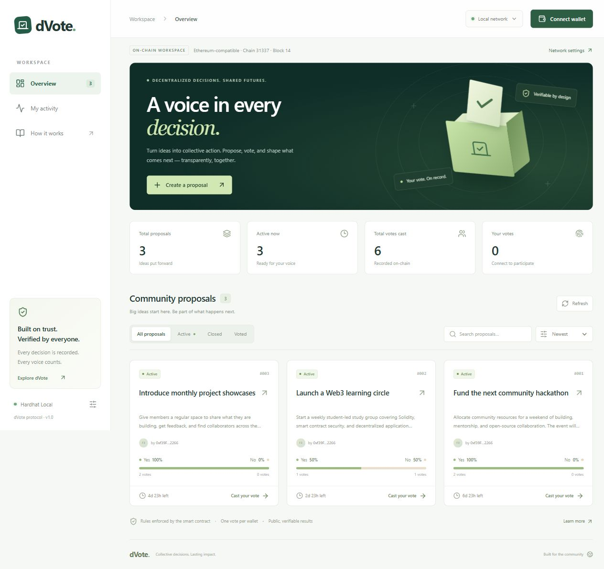

# dVote — Decentralized Voting

A local Ethereum voting dApp built with Solidity, Hardhat, React, Vite, Tailwind CSS, and ethers.js. Create proposals, vote Yes or No once per wallet, and inspect public results. Designed as a GDGoC technical interview demonstration.



Repository: [malpurearchit25/gdg-dvote](https://github.com/malpurearchit25/gdg-dvote). See the [project report](docs/PROJECT_REPORT.md), [architecture](docs/ARCHITECTURE.md), [requirement map](docs/REQUIREMENTS.md), [interview guide](docs/INTERVIEW.md), and [screenshot gallery](screenshots/README.md).

## Quick start on this Windows computer

Open PowerShell in the project folder:

```powershell
cd D:\Archit\Others\gdg-dvote
.\run.cmd dev
```

Open the **Local URL printed in the terminal**, normally http://127.0.0.1:5173. Keep the terminal open; use Ctrl+C to stop. If that port is occupied, Vite prints a different port.

You can also double-click `run.cmd` to start the frontend. The Windows launcher uses Node.js from PATH or this computer's bundled Codex runtime. The dependencies have already been installed here.

The initial workspace is an explicitly labeled **interactive demo**. Click **Connect wallet** to use a simulated account, create a proposal, and vote. This mode uses browser storage and fictional sample totals; it does not call a blockchain. Demo account connection resets on page reload, but proposals and voting history persist. Reconnect to see your history. Reset demo data from the network menu.

## Run the actual blockchain application

Use two PowerShell terminals. Stop any old local node first if port 8545 is occupied. Keep the node terminal open during the entire session.

**Terminal 1 — local blockchain:**

```powershell
cd D:\Archit\Others\gdg-dvote
.\run.cmd node
```

**Terminal 2 — deploy and start frontend:**

```powershell
cd D:\Archit\Others\gdg-dvote
.\run.cmd deploy
.\run.cmd seed
.\run.cmd dev
```

`seed` is optional. It adds three real proposals and six votes on the local chain each time it runs. Account 0 creates and votes Yes on all three; account 1 votes Yes, No, Yes. Use account 2 or another account to demonstrate new votes.

`deploy` writes the contract ABI, address, chain ID and RPC URL into `frontend/src/contracts/deployment.json`, and saves a deployment record in `deployments/31337.json`. Reload the browser after deployment. Each deployment creates a new contract; the frontend configuration points to the newest one.

Open the frontend, select **Use blockchain**, and connect an Ethereum-compatible browser wallet. Use Chrome/Edge with a wallet extension for real wallet approval; an embedded preview may not expose a wallet extension.

Add the following custom local wallet network:

| Setting | Value |
| --- | --- |
| Network name | Hardhat Local |
| RPC URL | `http://127.0.0.1:8545` |
| Chain ID | `31337` |
| Currency symbol | `ETH` |

Import one of the **development account private keys printed by your local Hardhat node** into a dedicated development wallet. Those accounts have local test ETH for gas. These are publicly known test keys; never use them with real assets or on a public network.

The app can request a network switch and can add Hardhat Local when your wallet reports the network is unknown. Proposals can be read without connecting a wallet. Creating and voting require wallet approval. After confirmation, totals refresh; contract events and a periodic RPC refresh also update the UI.

Restarting the Hardhat node clears local state. Run `deploy` and optionally `seed` again, then reload the page. If your wallet reports a nonce conflict after a node reset, clear that development account's activity/nonce data in the wallet settings. Keep the node bound to loopback, as configured.

## Installation on another computer

Prerequisites: Node.js 22 or 24 LTS and pnpm. On Windows, the helper can also locate the bundled Codex runtime when present.

```powershell
cd D:\Archit\Others\gdg-dvote
.\run.cmd install
.\run.cmd dev
```

Alternatively, standard cross-platform commands from the repository root:

```sh
pnpm install --frozen-lockfile
pnpm dev
pnpm node
# In a separate terminal:
pnpm deploy
pnpm seed
```

The project intentionally pins its dependencies and uses the pnpm lockfile. The Solidity compiler is installed locally as `solc@0.8.24`; compilation does not require a separate compiler download. `pnpm-workspace.yaml` explicitly allows the native build steps used by the pinned dependencies.

## Verification and production build

```powershell
.\run.cmd test
.\run.cmd frontend
.\run.cmd build
# With the node running and contract deployed:
.\run.cmd integration
# Actual frontend ethers transport against local RPC (creates an isolated test contract):
.\run.cmd wallet
```

The 15 smart contract tests cover valid proposal storage, any-wallet creation, both events, input limits including UTF-8 bytes, duration boundaries, Yes/No tallies, wallet voting status, duplicate voting, separate proposals, voting one second before and exactly at/after the deadline, nonexistent proposals, complete retrieval, and pagination.

The 17 frontend tests cover demo proposal creation, vote persistence, duplicate-vote prevention, search, closed results, wallet rejection, account/network changes, submitted/confirmed feedback, overlapping refreshes, subscription cleanup, network switching and error decoding. Four additional wallet transport tests use the actual frontend service with an EIP-1193 test wallet against local RPC. They deploy an isolated contract and exercise creation, voting, duplicate rejection and a changed account. These tests do not automate a real browser extension; complete [the manual checklist](docs/WALLET-CHECKLIST.md) for that acceptance step.

GitHub Actions is configured to install from the lockfile, run the contract/frontend checks, build the frontend, start an isolated local node and run the wallet transport suite. `pnpm check` runs the contract tests, frontend tests and build locally.

The integration check uses local node accounts 2 and 3. It creates a real proposal, records a No vote, verifies counts, and attempts a duplicate using a read-only static call. It leaves its test proposal in the local chain.

`build` creates `frontend/dist/`. To serve the build locally, use `.\run.cmd preview` and open the printed URL. For a static host, publish that directory. A remotely hosted frontend's loopback RPC still refers to the visitor's machine; it does not provide a shared blockchain. This project ships as a local prototype, with no public testnet contract or hosting configured.

## Features

- Responsive dashboard with active/closed status and community statistics.
- Proposal creation with a UTF-8 byte limit and a 1-minute to 30-day voting window.
- Detail dialog with creator address, local-time deadline, vote counts and percentage bars.
- One vote per wallet per proposal, enforced by Solidity.
- Account/network change handling, local network switching and wallet disconnection from the UI.
- Pending wallet approval, submitted hash, confirmation and readable errors.
- Search, status filters, sorting, and personal activity for created proposals and votes.
- Explicit demo mode, independent from blockchain state.
- Paginated contract reads, contract events and periodic result refresh.

## Architecture

```text
React UI → ethers.js → browser wallet → JSON-RPC → Voting.sol
                  ↘ read-only RPC provider ↗

Demo mode → localStorage (separate, fictional data)
```

The core app has no centralized API or database. Private keys remain in the browser wallet. The deployment and seed scripts use unlocked development accounts from the local node.

```text
contracts/Voting.sol                  Voting rules, storage, events
test/Voting.test.js                   Automated contract tests
scripts/deploy.js                    Deployment and frontend configuration
scripts/seed.js                      Optional local sample transactions
scripts/integration.js               Live RPC integration check
scripts/start.js                     Portable command launcher
frontend/src/App.jsx                 Dashboard, dialogs, wallet and transaction UI
frontend/src/services/blockchain.js   RPC reads, wallet writes, error decoding
frontend/src/services/demo.js         Independent browser demo data
frontend/src/contracts/deployment.json Generated address and ABI
frontend/src/styles.css              Responsive visual design
frontend/vite.config.js               React and Tailwind build configuration
run.cmd                              Windows launcher
```

Run all package commands from the repository root. `frontend/package.json` only declares the frontend's ES module boundary; the root manages dependencies and scripts.

## Contract interface

| Method | Purpose |
| --- | --- |
| `createProposal(title, description, duration)` | Creates a proposal; duration is in seconds. Returns a zero-based ID. |
| `vote(proposalId, support)` | Records Yes (`true`) or No (`false`) for the caller. |
| `getProposal(proposalId)` | Returns one proposal or reverts for a missing ID. |
| `getAllProposals()` | Convenience getter for small demos. |
| `getProposals(offset, limit)` | Returns up to 100 proposals per call. |
| `proposalCount()` | Returns the number of proposals. |
| `hasVoted(proposalId, account)` | Checks whether a wallet already voted. |

IDs are zero-based on-chain. The UI displays human-facing numbers starting at #001. Titles must contain non-whitespace content and be 1–120 bytes; descriptions 1–2,000 bytes. Duration is 60–2,592,000 seconds. Voting is permitted only while `block.timestamp < deadline`. There is no owner override, cancellation, result manipulation or administrative vote function. The frontend estimates remaining time between blocks; the contract's timestamp check is authoritative.

Events: `ProposalCreated(proposalId, creator, title, deadline)` and `VoteCast(proposalId, voter, support)`. Both IDs and addresses are indexed for independent verification through JSON-RPC logs. Custom errors identify validation failures.

## Limitations

One wallet is not one human. Multiple wallets can belong to one person; there is no eligibility verification or Sybil resistance. Choices and wallet addresses are public, including in transaction calldata and events. This is not a secret ballot system. There is no quorum or governance execution, and the displayed outcome is the simple Yes/No majority. The contract is not audited and is intended for learning, not binding elections. Public network deployment would require separate configuration, funds for gas, and security review.

The frontend pages contract reads but still loads the full collection into memory; high-volume use would benefit from incremental pagination or an indexer. There is no transaction explorer on the default local chain; copy transaction hashes for inspection with ethers.js or a local RPC tool.

## Interview demonstration

1. Start the local node, deploy, and optionally seed.
2. Open blockchain mode and connect an unused funded development account.
3. Create a 1-minute proposal. Show the wallet approval and confirmed transaction.
4. Vote Yes and inspect the updated count. Explain `hasVoted` and `VoteCast`.
5. Show that the UI prevents a second vote; run tests to demonstrate on-chain rejection too.
6. Switch wallet accounts and vote No on the same proposal.
7. Wait for the deadline and show Closed status and the final result.
8. Explain public ballots, one-wallet limitations, and how the contract rejects late transactions.

Implementation references: [ethers v6 documentation](https://docs.ethers.org/v6/single-page/) and [Hardhat local compiler configuration](https://v2.hardhat.org/hardhat-runner/docs/other-guides/using-custom-solc).
