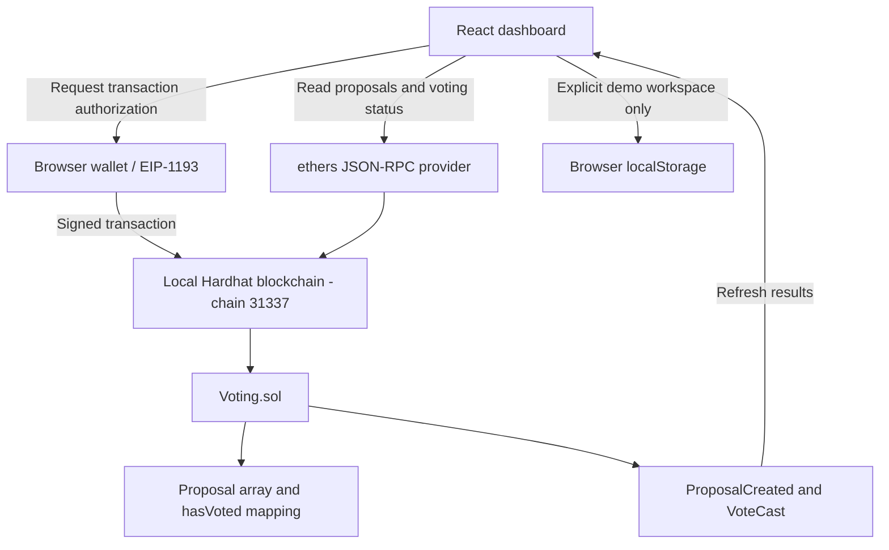

# System design

## Write sequence

1. Validate the form and confirm the wallet account/network.
2. Call `createProposal` or `vote` using an ethers `BrowserProvider` signer.
3. The wallet requests approval. If declined, the app reports the error.
4. After submission, show the transaction hash and pending state.
5. The contract validates and either reverts atomically or updates state and emits an event.
6. Wait for a successful receipt, then fetch the updated proposal list.

## State and invariants

Proposals have zero-based IDs, title, description, creator, deadline, Yes count and No count. Human-facing IDs begin at #001.

- A wallet can vote at most once on a given proposal.
- A valid vote increases exactly one count by one.
- Voting is allowed only when `block.timestamp < deadline`.
- Invalid IDs revert before accessing proposal state.
- Titles and descriptions are bounded in UTF-8 bytes; durations are 60 seconds through 30 days.
- Anyone may create a proposal. There is no administrative tally modification.
- Contract validation is authoritative even if the browser is modified.

The chain is the source of truth. UI countdowns estimate current time between blocks. Events and periodic reads keep the dashboard updated. Wallet account and chain change events update account-specific state.

## Trust boundaries and limits

Private keys remain in the wallet. The app receives public addresses and submits contract call requests. Development scripts use unlocked local test accounts. Demo data never becomes blockchain state.

Wallet addresses are not verified people. Proposal contents and vote choices are public. There is no quorum, identity registry, secret ballot, upgrade path or automatic execution of a passed proposal. The local node is a single development process and resets when restarted. This is an educational demonstration, not an audited election system.

An attacker can create many wallets or proposals. Text-length bounds limit individual writes but do not prevent spam. Paging bounds a single read response, while the present UI still loads all pages. A public deployment would need separate consideration of eligibility, availability, indexing, costs and security review.
